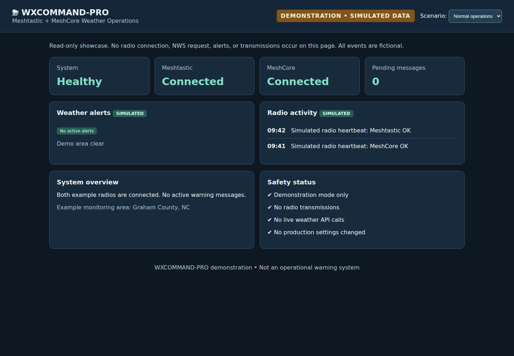
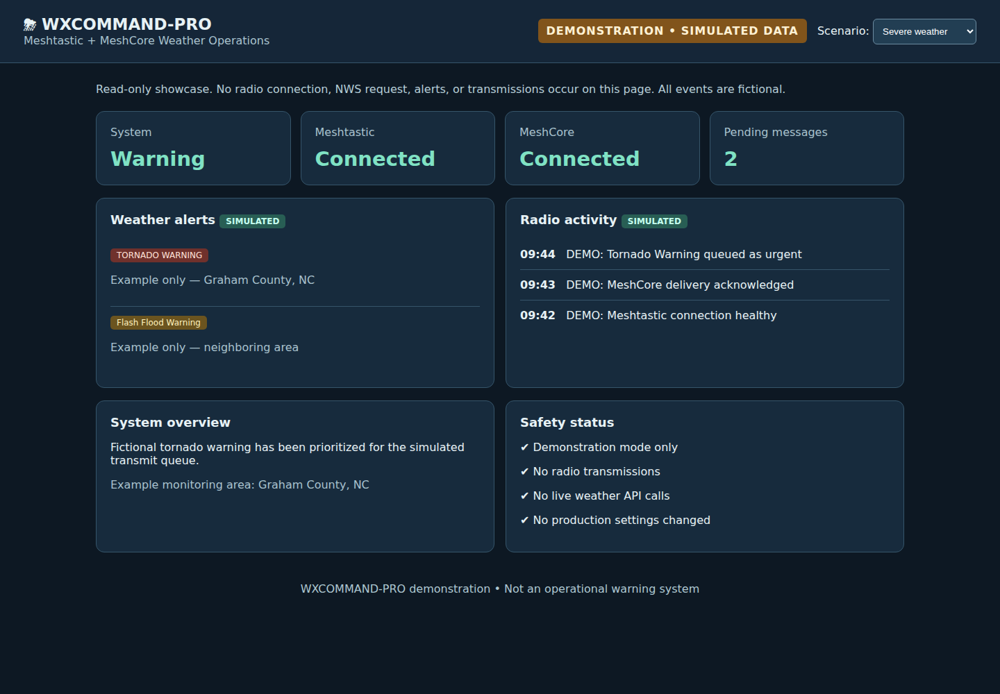
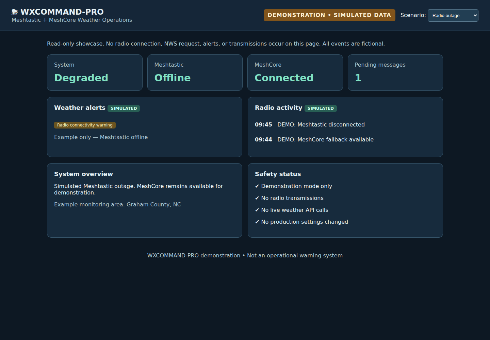

<div align="center">

# WXCOMMAND-PRO

### Weather Intelligence. Mesh Communications. One Command Center.

**Self-hosted weather and public safety alert monitoring for Meshtastic and MeshCore networks.**

Monitor National Weather Service alerts, review radio connectivity, and manage controlled broadcasts from a single web interface.

**Raspberry Pi · Linux · macOS · Meshtastic · MeshCore**

</div>

---

## Screenshots

The screenshots below are generated automatically from the **simulated demonstration dashboard**, not live weather or radio hardware. On successful pushes to `main`, GitHub Actions refreshes the images in `docs/screenshots/`.

### Normal operations


### Severe weather simulation


### Radio outage simulation


Run WXCOMMAND-PRO locally and open `/demo` to explore the scenarios. This demonstration is read-only and does not transmit over radios.

## Overview

WXCOMMAND-PRO is a self-hosted weather monitoring and mesh radio broadcast platform. It connects public alert information with compatible off-grid radio networks, helping operators maintain situational awareness and distribute concise alerts over LoRa.

Designed for radio enthusiasts, community mesh networks, and emergency communications experimentation, the project emphasizes **operator control, clear status reporting, and cautious transmission defaults**.

> [!IMPORTANT]
> **Supplemental information only.** WXCOMMAND-PRO is not an official, certified, or guaranteed emergency warning system. It requires internet access to retrieve new alerts, and radio delivery depends on hardware and network conditions. Continue using NOAA Weather Radio, Wireless Emergency Alerts, and local official warning channels.

## Capabilities

| Area | Capabilities |
| --- | --- |
| Weather intelligence | NWS alert polling, configurable coverage, event filtering, update handling, and duplicate suppression |
| Public safety | Experimental IPAWS integration with dedicated configuration and test safeguards |
| Mesh radios | Meshtastic and MeshCore transport support, connection status, reconnection logic, and optional failover |
| Operator Center | Radio health, alert history, broadcast activity, diagnostics, and display preferences |
| Geographic awareness | Informational NWS warning polygon preview; not used to make transmission decisions |
| Reliability | Dry-run mode, bounded payloads, operational logs, scheduled database backups |
| Deployment | Raspberry Pi systemd setup helper and local macOS app launcher |

**Development status:** Active development. Phase 3 and Phase 4 changes are under review; features on those branches are not necessarily present in the stable main branch. Hardware compatibility and live transmission behavior must be validated for each installation.

## Quick start

### Raspberry Pi / Linux

1. Install Python 3.11 or newer and Git.
2. Clone the repository and open its directory.
3. Create an environment and install dependencies:

```bash
python3 -m venv .venv
.venv/bin/python -m pip install -r requirements.txt
```

4. Start WXCOMMAND-PRO:

```bash
.venv/bin/python -m app.main
```

5. Open the local dashboard using the host and port configured for your installation. The Phase 4 branch defaults to **127.0.0.1:8000** for safety.

For the Raspberry Pi service installer and restart procedures, see [Installation and Operations](docs/INSTALLATION.md).

### Intel macOS

After setting up the same Python environment, run:

```bash
python3 deploy/build_macos_app.py
```

Open `dist/WXCOMMAND-PRO.app`. This is a **local unsigned launcher**, not a notarized standalone distribution. It depends on the repository and its Python environment remaining in place.

### Before enabling radio broadcasts

1. Configure the NWS contact information and the areas to monitor.
2. Connect a compatible Meshtastic or MeshCore radio.
3. Confirm the intended live and test channels.
4. Leave **dry-run enabled** while reviewing alert decisions.
5. Verify behavior on a dedicated test channel before enabling live transmissions.

Do not expose the dashboard to the public internet without reviewing authentication and access controls.

## Operator Center

The Phase 4 development branch includes an Operator Center at `/operator` with radio status, system health, activity history, diagnostic summaries, and a simplified informational alert map.

The map is **not** a precise GIS tool and does not determine which alerts are broadcast. Some planned functions, including a complete setup wizard, persistent notification history, and offline PWA support, remain unfinished.

## Documentation

- [Installation and Operations](docs/INSTALLATION.md)
- [Phase 3 Setup and Validation](docs/PHASE3_SETUP.md)
- [Release Readiness Checklist](docs/RELEASE_CHECKLIST.md)
- [Draft Release Notes](docs/RELEASE_NOTES_1.2.0_DRAFT.md)

## Development and releases

**Current published version is not being changed by this branding update.** Version 1.2.0 remains a draft until CI, security, platform, and radio acceptance checks are complete.

Issues and contributions are welcome. Include the operating system, radio hardware, connection method, and relevant sanitized logs when reporting problems. Avoid posting device credentials or private identifiers.

## Independence and trademarks

WXCOMMAND-PRO is an independent project. It is **not affiliated with, endorsed by, or an official product of** Meshtastic, MeshCore, NOAA, the National Weather Service, or FEMA. All respective names and trademarks belong to their owners.

---

<div align="center"><strong>WXCOMMAND-PRO</strong><br>Weather Intelligence · Mesh Radio Operations · Operator Control</div>
